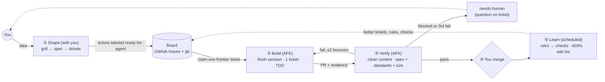

# Proposal: an agentic workflow where you own the spec and the merge, and agents do the rest

**Status:** draft for discussion · **Date:** 2026-10-24

## TL;DR

You asked for a hierarchy: you → griller → a project-specific "software shop" of agents that plans, implements and reviews, then hands back. The research says the shape you want is right, but the mechanism isn't. What works in production today is:

1. **A board, not an org chart.** Agents coordinate through durable artifacts (spec, tickets, git, progress notes), not by talking to each other through layers of managers. The issue tracker *is* the queue you imagined.
2. **One writer per piece of work.** Parallelism across independent tickets, never several agents writing the same area. Extra agents add *judgment* (review, QA), not more hands on the code.
3. **Fresh context per ticket.** Every unit of work starts in a clean session, sized to fit one context window, and leaves an artifact for the next. This is the cure for context rot.
4. **Separate the doer from the grader.** A clean-context verifier with hard pass/fail criteria replaces *you* as the verification loop. This is the thing that actually lets you stop supervising.
5. **Memory with one home per fact.** Decisions live in exactly one place, carry a status, and get superseded, not appended to. CLAUDE.md is a short list of pointers. This is the cure for memory rot.

You already have most of the pieces: Matt Pocock's `grill-with-docs → to-spec → to-tickets → triage → implement-spec → code-review → retro` covers the shaping, execution and learning stations. What's missing is (a) a dispatcher so work starts without you, (b) a verifier you trust enough to skip watching, (c) an escalation path, and (d) memory hygiene. The plan below adds those four things, in phases, starting from the smallest loop that works.

**What you're actually looking for:** your job moves from *supervisor of implementation* to *owner of the spec and the merge button*. The leverage is in ticket quality and verification, not in more layers of agents.

---

## 1. What the research says

### 1.1 "Hierarchy is bad" is half right

The real failure modes are more specific than "hierarchy":

| Failure mode | Evidence | Implication |
|---|---|---|
| **Parallel writers make conflicting implicit decisions** | Cognition: "Actions carry implicit decisions… decision-making can get quite fragmented in a multi-agent world where multiple agents are taking write actions." Still holds in their April 2026 follow-up. | One writer per area. Parallelize only across truly independent tickets. |
| **Telephone game through layers** | Anthropic's research system: vague delegation made subagents "duplicate work, leave gaps." Fix was subagents writing to a filesystem and passing *references* back. | Communicate through artifacts and pointers, not summaries passed down a chain. |
| **Persona role-play** | Cognition calls "you're a senior software engineer" a gimmick of prompt engineering; context engineering is what lasts. | A "PM agent", "architect agent" and so on adds tokens, not capability. Roles should differ by *context and criteria*, not job titles. |
| **Unstructured swarms** | Cognition: "arbitrary networks of agents negotiating with each other, is mostly a distraction. The practical shape is map-reduce-and-manage." | One manager layer, flat workers. Depth of one. |
| **Cost** | Anthropic: agents use ~4× the tokens of chat, multi-agent ~15×. The planner/generator/evaluator harness was "over 20x more expensive" than solo; a 4-hour app build cost $124. | Spend extra agents only where they pay. You're already near your weekly limit, so this is a real constraint. |

What *does* work is a hierarchy that's **one level deep** (a manager splits work, children execute, the manager synthesizes), where **writes stay single-threaded** and **extra agents contribute intelligence rather than actions** (Cognition, *Multi-Agents: What's Actually Working*).

### 1.2 What Anthropic's own harness experiments found

Two Anthropic engineering posts are the closest thing to your "software shop":

**Long-running agent harness** (*Effective harnesses for long-running agents*):
- Agents work in shifts with no memory, "like engineers working in shifts where each new engineer arrives with no memory of what happened on the previous shift."
- An **initializer** writes a feature list (200+ items, all marked failing), an `init.sh`, a progress log and an initial commit. Every later **coding session** reads the progress file and git log, runs a smoke test, picks **one** feature, commits, and updates the progress log.
- The feature list is **JSON, not Markdown**, because "the model is less likely to inappropriately change or overwrite JSON files," and agents may only flip a `passes` field.
- Failure modes it fixed: one-shotting, **declaring victory early**, leaving undocumented half-work, and marking features done without end-to-end testing.

**Planner / generator / evaluator** (*Harness design for long-running application development*):
- A **planner** expands a 1–4 sentence prompt into a product spec, kept at the product level because errors in granular technical detail "cascade into the downstream implementation."
- Before each chunk of work, generator and evaluator negotiate a **sprint contract** that says what "done" looks like.
- The **evaluator** clicks through the running app with Playwright and grades against criteria with **hard thresholds**. "Out of the box, Claude is a poor QA agent… identify legitimate issues, then talk itself into deciding they weren't a big deal." It took several rounds of reading logs and tuning the prompt to fix.
- **Self-evaluation is the core problem**: agents "confidently praise the work." But "tuning a standalone evaluator to be skeptical turns out to be far more tractable than making a generator critical of its own work."
- **Scaffolding goes stale.** With a stronger model, the sprint structure became unnecessary and the evaluator only paid off "when the task sits beyond what the current model does reliably solo." "Every component in a harness encodes an assumption about what the model can't do on its own… those assumptions… can quickly go stale as models improve."

### 1.3 Context rot and memory rot

- **Context rot is real and measurable**: "as the number of tokens in the context window increases, the model's ability to accurately recall information from that context decreases" (*Effective context engineering*). The goal is "the smallest possible set of high-signal tokens."
- **Fresh sessions beat corrected sessions**: "If you've corrected Claude more than twice on the same issue in one session, the context is cluttered with failed approaches… A clean session with a better prompt almost always outperforms a long session with accumulated corrections" (*Claude Code best practices*).
- **Clean-context reviewers find more**: Cognition's review agent catches about 2 bugs per PR, 58% severe, and works best when it shares *no* context with the coder, partly because of context rot in the coder's long session.
- **Reviewers cause bloat if you let them**: "A reviewer prompted to find gaps will usually report some, even when the work is sound… Chasing every finding leads to over-engineering: extra abstraction layers, defensive code, and tests for cases that can't happen. Tell the reviewer to flag only gaps that affect correctness or the stated requirements." This is directly relevant to your "bloated code" problem.
- **Bloated steering files get ignored**: "Bloated CLAUDE.md files cause Claude to ignore your actual instructions!" Matt Pocock's `retro` goes further: CLAUDE.md should hold "usually only navigation pointers"; coding standards belong to the *reviewer*, who has the least context pressure; and mechanical rules should become lint checks, not prose.
- **Knowledge should be compiled, not re-derived**: Karpathy's *LLM Wiki* pattern uses immutable raw sources, an LLM-maintained wiki, a schema file, `index.md` and `log.md`, plus a periodic **lint** pass that looks for "contradictions between pages, stale claims that newer sources have superseded, orphan pages." That lint pass is the antidote to agents getting hung up on conclusions that are no longer valid.

### 1.4 How heavy users actually run

I couldn't find public figures on Anthropic employees' per-person token use; I'd treat "billions per day" as unverified. What's public about how heavy users work:

- **Boris Cherny (created Claude Code)**, per secondary coverage: 5 parallel terminal sessions plus 5–10 web sessions, each in its own checkout. Starts in plan mode and iterates on the plan before auto-accepting. Keeps a team CLAUDE.md that gets a line every time Claude makes a mistake. Has a `/commit-push-pr` command. Uses dedicated subagents for code simplification and end-to-end verification. His top tip is to "give Claude a way to check its own work."
- **The pattern is many parallel, independent, single-writer sessions, each with a verification loop**, not an org chart of agents.
- **Matt Pocock's AFK "Ralph" loop**: a dumb loop feeding a GitHub-issues backlog to an agent, one ticket per run, TDD, vertical slices. An AI Engineer Europe 2026 talk found that a fancier dependency-graph planner caused *duplicate work across parallel agents* and pushed the speaker back to simpler task selection.
- **Steve Yegge's Gas Town / Beads**: 20–30 parallel agents coordinated through a dependency-aware, agent-maintained issue graph. Again, the coordination substrate is a tracker.
- **Platform convergence**: Anthropic's **Claude Code Projects** (beta, Sept 2026) is a coordinator chat plus worker threads. Each thread is a cloud session on its own branch, threads share project memory, and overlaps surface as ordinary merge conflicts. That's the map-reduce-and-manage shape productized.

### 1.5 Practical constraints in your environment

- **Scheduled tasks** (`/schedule`, claude.ai/code/routines) run Claude Code in the cloud on a cron schedule, an API call or a GitHub event, and push to `claude/`-prefixed branches. **GitHub triggers only support pull request and release events**, not issues. So "ticket labeled `ready-for-agent` → agent starts" needs either a polling schedule or a GitHub Action (`anthropics/claude-code-action` supports issue label triggers; confirm the setup in Phase 2).
- Scheduled runs **draw from the same subscription usage** as interactive sessions. A green run status "does not mean the work your prompt describes succeeded," so read the transcript.
- **Projects** threads also draw from your usage, and Anthropic warns they "can reach usage limits faster."
- **Local models** (decided in §2.5): Claude Code can use a local model server through `ANTHROPIC_BASE_URL` (llama.cpp, Ollama and LM Studio now support Anthropic's API format). Cloud sessions and scheduled tasks can't reach a model on the owner's PC, so a local builder means a local dispatcher (§2.3, option F).

---

## 2. The proposed design

### 2.1 Shape: a pipeline around a shared board



There's one coordinator (the dispatcher) and flat workers. Nobody talks to anybody except through the board and git. Each station gets different **context and criteria**, not a different persona.

### 2.2 The stations

#### ① Shape: the only stage that needs you live
- **Skills:** `grill-with-docs` (builds `GLOSSARY.md` and ADRs as you go), then `to-spec`, then `to-tickets`. For anything too big for one session, use `wayfinder` first to resolve the open decisions as tickets.
- **Output:** a spec issue, plus child tickets labeled `ready-for-agent` with native blocking links.
- **Ticket readiness bar** (a ticket the builder can't misread): end-to-end behaviour, acceptance criteria as checkboxes, named modules or areas, the verification command, what's out of scope, and a stop condition. Sized to fit one fresh context window. This is the "sprint contract" from Anthropic's harness, written up front.
- **Keep the spec at product level.** Let the builder choose the implementation path; over-specified technical detail cascades errors (Anthropic planner finding).
- **Gate 1:** you approve the ticket breakdown. That's the last thing you approve before the PR.

#### ② Build: one ticket, one fresh session, one writer
- Triggered by the dispatcher (see 2.3). It claims the ticket first (assign it, label `in-progress`) so no other worker takes it.
- The **startup ritual** comes from the long-running harness: read the ticket, the spec and recent progress comments, check `git log`, run the smoke check (`init.sh` or `make verify`), and only then write code.
- **Uses the `tdd` skill.** Red, green, refactor, one vertical slice at a time.
- **Never edits acceptance criteria or the tests that define them.** It can propose a change by commenting on the ticket.
- **Leaves a clean state:** a commit and a short progress comment on the ticket saying what was done, what was learned, and what's left. This is your `claude-progress.txt`, but on the ticket where the next agent will look.
- **If it's stuck or the ticket is ambiguous**, it asks a question on the ticket, labels it `needs-human`, and stops. It never guesses on product decisions.
- **Parallelism rule:** run tickets in parallel only if they're on the frontier *and* touch different areas (use `area:*` labels, one ticket in flight per area). This is how you avoid Cognition's conflicting implicit decisions. Multi-ticket specs integrate on one integration branch, as `implement-spec` already does.

#### ③ Verify: the piece that replaces you as the verification loop
- Runs in a **separate session with no shared context**: it gets the diff, the ticket and the spec, nothing else.
- Three checks, using Matt's two-axis `code-review` plus Anthropic's evaluator:
  1. **Spec:** does it do what the ticket and spec say? Walk every acceptance criterion.
  2. **Standards:** does it follow `CODING_STANDARDS.md`? The reviewer owns standards; the builder doesn't carry them.
  3. **End to end** (for UI or service work): run it the way a user would (Playwright for web, real requests for APIs) and attach evidence such as test output, screenshots or command transcripts.
- **Only correctness and requirement findings block.** Everything else goes in a non-blocking "notes" list. This is your bloat control.
- **Calibrated to be skeptical:** hard pass/fail thresholds, and a prompt tuned by reading its logs and fixing cases where its judgment diverged from yours. Budget a few rounds of this; Anthropic did.
- **Bounce limit:** up to two fix rounds with the builder. A third failure becomes `needs-human`. This stops the endless loops Cognition mentions.
- **Use it where it pays.** For trivial tickets, the deterministic checks (tests, typecheck, lint in CI) may be enough. Anthropic found the evaluator is "worth the cost when the task sits beyond what the current model does reliably solo." Start with it on everything, measure, then turn it down per ticket type.

#### ④ Integrate: Gate 2
- You review the PR **from evidence, not by re-running it**: the summary, the criteria walk-through, test output and screenshots (Matt's `pr` skill shape).
- **Agents never merge their own work.** This is universal across every practitioner source I found.

#### ⑤ Learn: how the system gets better instead of rotting
- **After each merged spec** (or weekly, as a scheduled task), run `retro` over the transcripts. Each finding is fixed in this order of preference:
  1. a **deterministic check** (lint rule, test, hook, CI job),
  2. a line in **`CODING_STANDARDS.md`** (read by the reviewer only),
  3. a **navigation pointer** in CLAUDE.md (last resort).
- **Memory lint** (see section 3) runs on the same schedule.
- **Harness review when a new model ships:** remove one piece of scaffolding at a time and see whether results hold. Pieces that aren't load-bearing are just stale assumptions.

### 2.3 The dispatcher: start simple, keep it replaceable

**Principle: the board is the system; the orchestrator can be swapped.** If all state lives in issues and git, you can change *what* pulls work without losing anything.

| Option | How it works | Pros | Cons | When |
|---|---|---|---|---|
| **A. Manual kick** | You open a fresh cloud session and run `implement-spec <spec>`. It works the frontier with subagents and then runs `code-review`. | Zero setup. Already exists. | You start each run. | **Phase 1** |
| **B. Scheduled pull** | A scheduled task (e.g. weeknights at 1 a.m., or every few hours) takes the oldest unblocked `ready-for-agent` ticket, claims it, builds it and opens a PR. A second task with a **`pull_request.opened`** trigger (filter: head branch starts with `claude/`) runs the verifier. | Native to your plan. No infrastructure. Runs while you sleep. | Polling, not instant. Draws on your weekly usage. | **Phase 2** (recommended default) |
| **C. GitHub Action** | `claude-code-action` fires on the issue being labeled `ready-for-agent`. | Instant, event-driven. | Needs a token or API key as a repo secret. Billed differently. | If B's latency hurts |
| **D. Claude Code Projects** | The coordinator chat routes tickets to threads with shared memory. | Productized map-reduce-and-manage. Steerable from your phone. | Beta. Memory lives outside your repo. Burns usage fastest. | **Phase 4** experiment |
| **E. Hermes Kanban** (Nous Research) | A board stored locally in SQLite. A dispatcher checks every 60s, claims tickets and spawns builder or reviewer workers in git worktrees. | The board, dispatcher, review step and loop limits are already built and handle the hard cases (see 2.3.1). | Not Claude Code. Needs a host you maintain. Claude usage bills to extra-usage credits or an API key. Encourages too many named agents. | Phase 2 alternative to F |
| **F. Local loop** | A script on the owner's PC, run by a systemd user timer (the PC runs Arch Linux, with no cron). It claims one frontier ticket, runs a headless builder session in a git worktree on the local model (§2.5), runs the deterministic gate, runs a headless Claude verifier, and applies the escalation ladder. | Stays in Claude Code, so it keeps the subscription, skills and hooks. Free builder tokens. Nothing to rent. | The PC must be on. Concurrency is 1, because there is one GPU. You maintain the script. | **Phase 2 (chosen, 2026-10-24)**, because the system runs locally and cloud scheduled tasks (B) can't reach a local model |

For whichever option you use, set a **concurrency cap** (start at 1–2 in-flight tickets) and a **nightly ticket budget**. You're at your weekly-limit warning today, so measure tokens per merged ticket before scaling.

#### 2.3.1 Hermes Kanban: helps if kept minimal, bloat if used fully

Hermes Kanban is an implementation of this proposal's board and dispatcher, not a competing design. Its docs describe it as a board where "every handoff is a row anyone can read and write," as opposed to "fragile in-process subagent swarms."

**What it adds over option B:**

| This proposal needs | Hermes Kanban provides |
|---|---|
| Dispatch without you | A dispatcher loop (default 60s) that claims tickets atomically, reclaims stale claims and recovers crashed workers |
| One writer per ticket, isolated | A `worktree` workspace per task |
| Verifier separate from builder | A built-in review step: `kanban_request_review` hands off to a reviewer, and `kanban_request_changes` sends work back to the original builder |
| Escalation path | `kanban_block` with a reason (`needs_input`, `capability`, `transient`, `dependency`) that surfaces to a human |
| Bounce and loop limits | `failure_limit` retry breaker (default 2), and tasks that keep re-blocking for the same reason go to triage |
| Agents never mark their own work done | Completion is refused unless the PR's required GitHub checks have passed ("A commit or diff alone never automatically completes a task") |
| Coordinator that can't write code | An orchestrator profile limited to board, gateway and memory tools |

**Where it turns into bloat or works against this design:**
1. **Named profiles, each with its own memory.** It invites a persona org chart (§1.1), and each profile's memory is private, so lessons fragment across agents. Use **at most three profiles**: orchestrator, builder, reviewer.
2. **Self-written memory and self-improving skills.** Both write automatically, which conflicts with "one home per fact" (§3). Memory is capped at about 2,200 characters, which helps. Turn on **memory write approval** and keep decisions in repo ADRs, not in agent memory.
3. **A second tracker.** Its SQLite board would duplicate GitHub Issues. Pick **one** place for work state. Specs, ADRs, glossary and code stay in the repo either way.
4. **Leaves Claude Code.** You lose hooks, auto-mode safety checks, cloud sessions and scheduled tasks. Skills mostly carry over, since Hermes follows the agentskills.io format.
5. **Hosting.** The dispatcher runs inside a long-running Hermes process, so you need a VPS with systemd linger and a GitHub login per profile. Its docs describe a single-host, trusted-local-user model, and workers run as your user account.
6. **Billing.** Per its provider docs, Claude through Hermes uses **extra-usage credits** or an API key, not your Claude Code plan allowance.

**If you choose it, the minimal setup:**
- one board per project, bound to the repo
- three profiles: orchestrator (board tools only), builder (Claude Code-equivalent tools plus `tdd`), reviewer (the verify rubric from §2.2 ③)
- `worktree` workspaces
- memory write approval on
- required GitHub checks on the repo
- `failure_limit: 2`
- the board as the only place work status lives

**Skip:** bot teams, messaging platforms, extra specialist profiles, unreviewed self-editing skills.

### 2.4 Where your "software shop" lives: a playbook, not a department

Your instinct to route ideas to a project-specific team is good. Implement it as a **playbook**, which is a plugin or skill bundle, rather than a standing hierarchy of persona agents:

```
playbooks/
  software/
    build.md            # builder instructions: startup ritual, TDD, progress comments, escalation
    verify.md           # verifier rubric: spec walk, standards, e2e, thresholds, bounce limit
    ticket-template.md  # readiness bar
    init.sh             # how to boot + smoke-test this kind of project
  research/
    build.md            # e.g. Matt's `research` skill: cited markdown from primary sources
    verify.md           # citation check, source quality, contradiction scan
  writing/ ...
```

**Routing** is just a label on the spec (`shop:software`, `shop:research`) that tells the dispatcher which playbook to load. Adding a new kind of shop means adding a folder, not a layer.

### 2.5 Model allocation: local builder, Claude for judgment

**Decision (2026-10-24):** the system runs locally on the owner's PC. The builder runs on a **local model**, and Claude models within the subscription handle shaping, verification and escalation. This applies "separate the doer from the grader" across models: the cheap model does the token-heavy work and a stronger model grades it.

**Machine** (surveyed in `comms/001`): RTX 3080 (10 GB VRAM), 32 GB RAM (about 27 GB free), Ryzen 9 5900X, Arch Linux (Omarchy), Ollama 0.40 already installed, Claude **Pro** plan. The GPU is shared with video-pipeline jobs under a one-GPU-job-at-a-time rule, so local-model sessions take a GPU lock. The limit is VRAM plus RAM. Mixture-of-experts (MoE) models up to roughly 35–40B total parameters fit at 4-bit, with expert weights held in system RAM. Dense models above about 14B are too slow for agent loops.

| Station | Default model | Why |
|---|---|---|
| ① Shape (grill → spec → tickets) | Claude Opus (Sonnet if the Pro plan doesn't offer Opus in Claude Code) | The owner is live and ticket quality is where the leverage is |
| Dispatcher | None (a script) | It picks and claims tickets; that needs no judgment |
| ② Build | **Local: Qwen3.6-35B-A3B** (MoE, 3B active, Q4) | The token-heavy station. Tickets that clear the readiness bar are what a 30B-class model can handle |
| Deterministic gate (new) | None | Tests, typecheck and lint run locally before any Claude review. A red build goes back to the builder at no subscription cost |
| ③ Verify | Claude Sonnet; Opus for the spec-level review and `area:` labels on the autonomy line | The grader must be stronger than the doer. Reading a diff and a ticket costs far less than building |
| Build escalation | Claude Sonnet, in a fresh session on the same ticket | Used before `needs-human` (see the ladder below) |
| ⑤ Learn: transcript first pass, wiki embeddings | Local | Bulk extraction and similarity search |
| ⑤ Learn: retro synthesis, wiki lint decisions | Claude Opus | Low volume, high judgment |
| Small jobs (CI log condensing, progress comments, commit messages, labels) | Local, or Claude Haiku | Cheap either way |

**Escalation ladder** (this replaces the ③ bounce limit when the builder is local): local builder, up to 2 bounces → a fresh Claude Sonnet builder session on the same ticket, up to 1 bounce → `needs-human`. The owner gets pulled in only after a stronger model has had a go.

**Swappable by design.** Each station's model lives in **one config file**, `config/models.env`, and `bin/station <station>` starts Claude Code on that station's model. Playbooks name stations, never models. Every station runs through Claude Code, so skills, hooks and the playbook stay the same whichever model is behind it:
- **Local model:** Ollama serves an Anthropic-compatible API. `bin/station` sets `ANTHROPIC_BASE_URL` to it, points the `ANTHROPIC_DEFAULT_{OPUS,SONNET,HAIKU,FABLE}_MODEL` aliases and `CLAUDE_CODE_SUBAGENT_MODEL` at the local model so background calls stay local, holds the GPU lock, and unloads the model when the session ends.
- **Claude model:** the station runs `claude --model sonnet` (or `opus`, `haiku`) on the subscription.
- Moving the builder to Ornith, Flint, a future Qwen model or Claude Sonnet is a one-line change. Ornith-1.5-35B-A3B is already on the PC and is the first challenger (79% SWE-bench Verified, self-reported, against Qwen3.6's 73.4%).

**Local runtime defaults** (tune in Phase 0):
- **Ollama first**, since it's already installed with flash attention, a q8_0 KV cache and one parallel slot. The model is `qwen3.6:35b-a3b` at 4-bit, wrapped as `qwen3.6-agent` with `num_ctx 65536` (Claude Code can't set context length through the API).
- **llama.cpp only if Ollama misses the speed target.** It gives explicit expert offload (`-ngl 99 -ncmoe N`, the `--jinja` template), but on this machine it needs cmake plus a CUDA 13.4 / gcc 16 host-compiler workaround.
- Expected speed, from similar cards: roughly 30–45 tok/s generation. Measure at empty and at ~30k context.

**Watch for:** Vendor benchmark scores (73.4% SWE-bench Verified for Qwen3.6-35B-A3B) are measured at full precision on the vendor's own setup, so expect less at Q4 inside Claude Code. A weaker builder also means more bounces, so Claude re-reviews more diffs and Gate 2 needs more of the owner's attention. **If fewer than about half of local-built tickets merge without help, the savings are gone.** In that case move the builder to Sonnet and keep local models for ⑤ and small jobs.

**Hardware upgrades:** 64 GB of RAM buys longer context and better quantizations, but no new class of model. The next class (Qwen3.8-Flash-Next, 125B-A6B) needs 96–128 GB. Don't buy anything before the Phase 1 data is in.

---

## 3. Memory: a "second brain" that doesn't rot

Three layers with different lifetimes. The rule throughout is that **every fact has exactly one home and everything else points to it.**

| Layer | Lives in | Contains | Lifetime | Rot control |
|---|---|---|---|---|
| **Work state** | Issues and git | Specs, tickets, progress comments, PRs | Until merged; then it's history | Closed tickets are *history, not instructions*. Agents read only open tickets plus pointers. |
| **Project truth** | Each project repo | `GLOSSARY.md`, `docs/adr/NNN-*.md`, `CODING_STANDARDS.md`, a short `CLAUDE.md` | Life of the project | ADRs carry `Status: accepted / superseded by NNN`. Superseded decisions are marked, never silently edited, never duplicated. CLAUDE.md passes the "would removing this line cause a mistake?" test. |
| **Personal brain** | **This repo** (`rylyk/agents`) as an LLM wiki | Your preferences, playbooks, cross-project lessons, research notes | Indefinite | Karpathy's pattern: `raw/` is immutable, `wiki/` is agent-maintained, plus `index.md` and an append-only `log.md`. Every claim has a date and source. A scheduled **lint** pass flags contradictions, stale claims, orphans and duplicates. |

Rules that directly target "hung up on conclusions that are no longer valid":
1. **Supersede, don't append.** A new decision gets a new ADR that marks the old one superseded, and the wiki page is rewritten, not added to. Append-only files are where stale conclusions go to live forever.
2. **Pointers over copies.** Tickets link to ADRs and spec sections; they don't paste them in. Matt's skills already do this ("a decision lives in exactly one place").
3. **Load just in time.** Agents read `index.md` and follow links, rather than having everything pushed into context at startup (Anthropic's "just in time" context).
4. **Handoffs are disposable.** A `handoff` doc bridges one session to the next and is then thrown away. Anything worth keeping gets promoted to an ADR, the glossary or the wiki.

---

## 4. Anti-patterns this design avoids

| You might be tempted to… | Instead… | Because |
|---|---|---|
| Build CEO → PM → Architect → Dev → QA agents | Use one dispatcher, flat builders and a clean-context verifier | Telephone game, ~15× tokens, persona prompts add little |
| Run several agents on one feature at once | Run one writer per ticket, and parallelize across areas only | Conflicting implicit decisions (Cognition) |
| Let the builder say "done" | Have a separate verifier with hard criteria and evidence | Agents "confidently praise the work" (Anthropic) |
| Keep one long session going and correct it | Use a fresh session per ticket, and `/clear` after two corrections | Context rot |
| Keep a growing `memory.md` / `NOTES.md` | Use ADRs with status, a wiki with lint, and pointers | Memory rot; bloated steering files get ignored |
| Have the reviewer flag everything | Block only on correctness and requirements; everything else is a note | Over-engineering and bloat |
| Encode every lesson in CLAUDE.md | Prefer a lint rule or test, then reviewer standards, then CLAUDE.md | Deterministic beats advisory |
| Design the full system up front | Start with the phases below and add only what measurement justifies | "Find the simplest solution possible, and only increase complexity when needed" (Anthropic) |

---

## 5. Rollout plan

Each phase has an exit test. Don't advance until it passes.

### Phase 0: local builder bring-up (an evening or two)
- Pull Qwen3.6-35B-A3B into Ollama as `qwen3.6-agent` (§2.5) and record generation and prompt-processing speed at empty and at ~30k context.
- Run a toy TDD task through `bin/station build`: write failing tests, make them pass. Watch for broken tool calls, and for background calls that still try to reach a Claude model.
- Optional: run the same task with Ornith-1.5-35B-A3B. The steps are in `comms/002`.
- **Exit:** at least ~25 tok/s generation at 32k context, and the toy task finishes with no malformed tool calls. If it doesn't, try Flint or a smaller quantization before moving on.

### Phase 1: single-lane loop, manual kick (about a week)
- Pick **one real project**. Run `/setup-matt-pocock-skills` with GitHub Issues as the tracker.
- Shape a small spec (3–6 tickets) with `grill-with-docs → to-spec → to-tickets`, using Opus.
- For each ticket, start a **fresh** local session with the builder station (one ticket per session rather than `implement-spec`, which leans on subagents and suits a stronger model). Then run the deterministic gate, then a separate, clean Claude session for verification using the spec, standards and e2e rubric. Then apply the escalation ladder (§2.5). Then you merge.
- Run 1–2 tickets through a Sonnet builder as well, for comparison.
- Write `playbooks/software/verify.md` from whatever the verifier missed.
- **Track per ticket:** builder model, merged without your intervention (yes/no), number of bounces, escalated to Sonnet (yes/no), `needs-human` count, **Claude usage per merged ticket**, and local wall-clock time.
- **Exit:** at least 60% of tickets merge without you touching the code, and Claude usage per merged ticket is clearly below the Sonnet-builder comparison.

### Phase 2: automatic dispatch
- Choose the dispatcher: **F** (local loop, the default since the system runs locally) or **E** (Hermes Kanban, more built in, but it bills Claude separately). See §2.3 and §2.3.1.
- With F, write the loop script: claim ticket → worktree → builder station → deterministic gate → verifier station → escalation ladder → PR or `needs-human`. Run it overnight from a systemd user timer (`loginctl enable-linger` so it runs while logged out). With E, use the minimal setup in §2.3.1.
- Add labels `ready-for-agent`, `in-progress`, `needs-human`, `area:*`. Set the concurrency cap to 1 and raise it later.
- **Exit:** a spec's tickets go from `ready-for-agent` to merge-ready PRs overnight, and the only thing you do is review the PRs.

### Phase 3: playbooks and the personal brain
- Move the software playbook into this repo as a plugin, and add a `research` playbook.
- Set up the LLM-wiki structure in this repo, with a weekly lint task and a weekly `retro` task.
- **Exit:** a lesson from project A shows up as a check or rule that prevents the same mistake in project B.

### Phase 4: try a managed coordinator
- Run the same spec through **Claude Code Projects** and compare it with Phase 2 on quality, how much you had to intervene, and usage. Keep the board as the source of truth either way.

---

## 6. Open questions for you

1. **Tracker:** GitHub Issues (native blocking links, works with triggers) or local Markdown tickets? I recommend GitHub Issues.
2. **First project:** which real project should be the Phase 1 guinea pig? Ideally one with a test suite or an obvious way to verify it.
3. **Budget:** what share of your weekly usage are you willing to give to AFK runs? This sets the concurrency cap.
4. **Non-software shops:** is research or writing a near-term need, or is software enough for now?
5. **Autonomy line:** are there areas (auth, billing, migrations, infrastructure) that should always be `ready-for-human`?
6. ~~**Local OS**~~ Answered in `comms/001`: Arch Linux (Omarchy), bash, systemd user timers.

From the survey: **`clippy`** (Python, about 1.4k lines, pytest) is the strongest pilot candidate, but it has no GitHub remote. That ties questions 1 and 2 together: either push it to a private GitHub repo and use Issues, or use local Markdown tickets.

**Decided (2026-10-24):** the system runs locally, with a local builder (Qwen3.6-35B-A3B) and Claude models in the subscription for shaping, verifying and escalation (§2.5). Dispatcher option F (§2.3).

---

## 7. Status and next steps

**Where things stand (2026-10-24):** proposal drafted, Hermes Kanban evaluated (§2.3.1), and model allocation decided (§2.5). The PC was surveyed (`comms/001`). `config/models.env` and `bin/station` are written but untested on the PC. Phase 0 is out as `comms/002` (cloud and local sessions talk through git for now; see `comms/README.md`). §6 questions 1–5 are open; the pilot is probably `clippy`.

1. **Phase 0 (`comms/002`):** the local session pulls Qwen3.6-35B-A3B into Ollama, measures speed, and runs the toy TDD task through `bin/station build`. Optionally, it repeats the task on Ornith. The cloud session then fixes `bin/station` from the report and sets `GPU_LOCK` to the video pipeline's lock.
2. **Answer §6 questions 1–2:** confirm `clippy` as the pilot, and choose between a private GitHub repo with Issues or local Markdown tickets.
3. **Prepare the pilot repo:** run `/setup-matt-pocock-skills` (already installed on the PC) with the chosen tracker, and make sure `python -m pytest` proves the app works.
4. **Draft the playbook in this repo:** `playbooks/software/build.md`, `verify.md` and `ticket-template.md`, following §2.2. Write `build.md` for the local model: short, explicit steps, and a hard stop condition. The verifier rubric still matters most. Tailor both to the pilot's stack.
5. **Shape one small spec live** with Opus (or Sonnet on Pro): `grill-with-docs`, then `to-spec`, then `to-tickets`, aiming for 3–6 tickets. The owner approves the breakdown.
6. **Run Phase 1 by hand (§5):** `bin/station build` → deterministic gate → `bin/station verify` → escalation ladder → owner merges. Run 1–2 tickets with a Sonnet builder for comparison, and record the per-ticket metrics.
7. **Write the Phase 2 local loop (option F)** once at least 60% of tickets merge without intervention. If they don't, fix the ticket template and verifier first. If the local builder is what fails, swap it in `config/models.env` before redesigning anything.

Keep this section current as steps complete. It is the handoff point between sessions.

---

## Sources

Primary:
- Anthropic: [Effective harnesses for long-running agents](https://www.anthropic.com/engineering/effective-harnesses-for-long-running-agents)
- Anthropic: [Harness design for long-running application development](https://www.anthropic.com/engineering/harness-design-long-running-apps)
- Anthropic: [How we built our multi-agent research system](https://www.anthropic.com/engineering/multi-agent-research-system)
- Anthropic: [Effective context engineering for AI agents](https://www.anthropic.com/engineering/effective-context-engineering-for-ai-agents)
- Anthropic: [Building effective agents](https://www.anthropic.com/engineering/building-effective-agents)
- Anthropic: [Claude Code best practices](https://www.anthropic.com/engineering/claude-code-best-practices)
- Anthropic: [Projects redesigned: from folder to conversation](https://claude.com/blog/projects-redesigned)
- Claude Code docs: [Scheduled tasks (routines)](https://code.claude.com/docs/en/routines)
- Cognition: [Don't Build Multi-Agents](https://cognition.ai/blog/dont-build-multi-agents)
- Cognition: [Multi-Agents: What's Actually Working](https://cognition.ai/blog/multi-agents-working)
- Matt Pocock: [mattpocock/skills](https://github.com/mattpocock/skills), especially `implement-spec`, `wayfinder`, `triage`, `to-tickets`, `retro` and `handoff`
- Andrej Karpathy: [LLM Wiki](https://gist.github.com/karpathy/442a6bf555914893e9891c11519de94f)
- Qwen: [Qwen3.6-35B-A3B](https://qwen.ai/blog?id=qwen3.6-35b-a3b)
- Nous Research: [Hermes Kanban](https://hermes-agent.nousresearch.com/docs/user-guide/features/kanban), [Hermes memory](https://hermes-agent.nousresearch.com/docs/user-guide/features/memory), [Hermes AI providers](https://hermes-agent.nousresearch.com/docs/integrations/providers)

Secondary (treat specifics with caution):
- [Boris Cherny's parallel workflow (NeuronFeed)](https://neuronfeed.com/news/anthropic-s-claude-code-creator-shares-parallel-agent-workflow-as-product-hits-1)
- [AI Engineer Europe 2026: Ralph loops talk](https://www.ai.engineer/talks/2TLXsxkz0zI-ralph-loops-build-dumb-ai-loops-that)
- [Matt Pocock: Tips for AI coding with Ralph Wiggum](https://www.aihero.dev/tips-for-ai-coding-with-ralph-wiggum)
- [Steve Yegge: Gas Town from Clown Show to v1.0](https://steve-yegge.medium.com/gas-town-from-clown-show-to-v1-0-c239d9a407ec)
- [Martin Fowler: Understanding spec-driven development (Kiro, spec-kit, Tessl)](https://www.martinfowler.com/articles/exploring-gen-ai/sdd-3-tools.html)
- [Background AI coding agents in 2026 (DEV)](https://dev.to/alexcloudstar/background-ai-coding-agents-in-2026-when-to-delegate-work-to-async-agents-3g92)
- [Gemma 4 26B A4B vs Qwen3.6-27B vs Qwen3.6-35B-A3B (gist)](https://gist.github.com/hungson175/61a805368649c225026a69adf2ad87e0)
- [Recursive Flint local coding model (MarkTechPost)](https://www.marktechpost.com/2026/10/21/recursive-flint-local-coding-model/)
- [Pairing Claude Code with local models (KDnuggets)](https://www.kdnuggets.com/pairing-claude-code-with-local-models)
- [One flag tripled tokens/sec on an 8GB GPU: `-ncmoe` (Medium)](https://medium.com/coding-nexus/one-flag-tripled-my-tokens-per-second-on-an-8gb-gpu-238f55d1e3bd)
